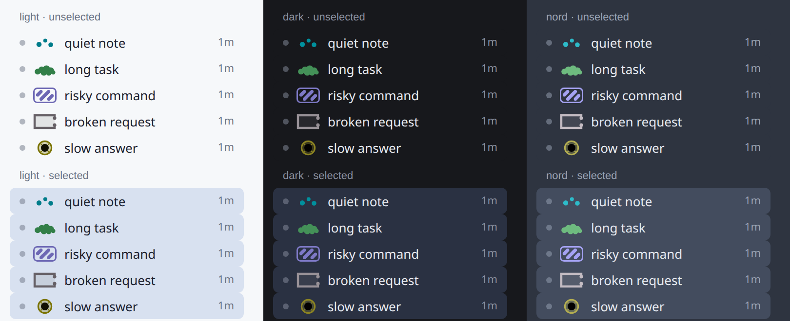

# cuttlefish-theme

Each of your [Hermes](https://github.com/NousResearch/hermes-agent) Desktop sessions keeps its own hue, and its state speaks in skin patterns — so a glance at the sidebar tells you which session is which, and which one is blocked on you.

cuttlefish-theme 2.0 is desktop-first, one plugin in two halves: a Desktop plugin that paints the surfaces you see, and a small Python half that turns approval, clarify and error hooks into plugin events so "needs you" reaches the Desktop the moment it happens. The classic CLI gets a static colour skin — explicit, opt-in, unanimated.

## Learn the language in 10 seconds

| state | pattern | row mark (24×16 chip) | what it means |
|---|---|---|---|
| `resting` | calm mottle | three small dots, nothing else | idle; the session's quiet hue |
| `working` | slow passing clouds | one solid, puffy cloud | busy; leave it alone |
| `needs you` | high-contrast zebra stripes | an outlined chip filled with bold diagonal stripes | blocked on your answer (approval or clarify) |
| `error` | blanching to pale | a pale **grey hollow square**, its frame broken at the right (no hue left) | something failed — an errored turn or model call |
| `finished` (unseen) | one dark eye-spot | a pale disc, crisp ring and one big dark core | a turn completed in a session you are not looking at |



In the chat field the organs live only on the right 40 % of the page, never behind the text, the title or the composer: stripes are diagonal bands of big dots, error is fewer, paler, colourless blobs, finished-unseen is one dark disc in the gutter. The composer rim is one pill, the same picture drawn full width: stripes, a train of cloud lobes, a pale wash inside a broken outline, one dark eye.

Hue is **which session** — its identity, held for the session's life. Pattern and brightness are **its state**. A state change never touches the hue.

The full vocabulary — signals, precedence, adding your own states, motion — is in [docs/LANGUAGE.md](docs/LANGUAGE.md).

<!-- screenshot: added at release -->

## Where it shows

- **Sidebar row swatches** — every session at a glance: one small state glyph per session row (the pictures in the table above), in that session's hue. The shape is the state; the hue is the session.
- **The focused session** — three quiet surfaces:
  - a faint, sparse chromatophore dot field behind the chat, drawn over your own background as a scatter of organs, never a fill; near-invisible at rest, it blooms briefly when the state changes and settles again;
  - a thin rim at the top of the composer that echoes the glyph (a hairline at rest, cloud dashes, diagonal stripes, a pale wash, one dark spot);
  - a status-bar strip that always says the state in words (`resting`, `working`, `needs you`, `error`, `done`).

All of it sits **beside** core's own amber/emerald status dots. The plugin never hides or replaces them, and never sets your theme or accent colour — your colours stay yours.

## Motion

- `still` (default) — at rest, nothing moves. Slow passing clouds run only while the session is working, and a state change gets one short bloom for a few seconds, then the field settles.
- `alive` — the resting field gets a slow twinkle as well.
- `off` — static frames only, nothing animates.

The plugin honours `prefers-reduced-motion`: under it, nothing animates regardless of config. There is one budgeted animation loop for everything, and it parks itself when nothing moves.

## Install

```bash
hermes plugins install wisechef-ai/cuttlefish-theme
```

1. Enable the Desktop plugin in **Settings → Plugins** (`cuttlefish-theme`).
2. For the Python half — needed for "needs you" in real time — add `cuttlefish-theme` to `plugins.enabled` in `config.yaml`. Without it, the Desktop falls back to polling the session list and learns about states only when a poll sees them.

Classic CLI (optional):

```bash
hermes cuttlefish skin                      # install the static colour skin (explicit, never auto-selected)
hermes config set display.skin cuttlefish   # then select it yourself
hermes cuttlefish doctor                    # version, config location, resolved settings, skin state
hermes cuttlefish legend                    # the vocabulary, as your config resolves it right now
```

## Settings

Config file only — there is no settings UI. Everything lives under `plugins.entries.cuttlefish-theme.settings` in `<hermes home>/config.yaml`, and an edit applies **without a restart**: the Desktop re-reads the file when it changes.

```yaml
plugins:
  entries:
    cuttlefish-theme:
      settings:
        intensity: 1.2        # 0..2 — how loud the skin is; 1 is near-invisible at rest, 0 switches the field off
        motion: still          # still | alive | off
        states:
          # remap a preset — any field you give replaces its default
          needs_you:
            pattern: mottle
          # add a state — a signal, a known pattern, a priority
          compacting:
            when: compacting
            pattern: zebra
            priority: 50
            label: compacting
```

The rules are the same in both halves (they share one set of test vectors): a rejected field keeps its default; a rejected new state or pattern is dropped whole; `null` removes a preset (the `resting` state cannot be removed); every miss produces a warning, never a crash. `hermes cuttlefish doctor` prints the resolved settings and any warnings. Keys and semantics: [contract/README.md](contract/README.md) and `contract/config-vectors.json`.

## Privacy and safety

- **No network.** The plugin talks only to the local Hermes process.
- **No core override.** The Desktop half uses the plugin SDK only (`@hermes/plugin-sdk`, `react`, `react/jsx-runtime`) and never restyles core UI by reaching into its DOM; the Python half writes no core attributes.
- **State, never text.** The Python half broadcasts session state only — never prompt, command or error text, which is where secrets live.

## Requirements

- Hermes `>= 0.22.0` (`requires_hermes` in [plugin.yaml](plugin.yaml)); built and tested against Hermes v0.22.7.
- The Desktop surfaces need the Hermes Desktop; the classic-CLI skin works everywhere else.

## Tests

```bash
make test           # the gate: lint + unit + the locked acceptance contract
make release-check  # adds the real-Desktop evidence and the submission kit
```

The acceptance contract pins the language itself, not just the code: instruments read the rendered pixels and must classify all five patterns on every session identity and background ([contract/README.md](contract/README.md)). Performance is measured in `evidence/` at release; no figures are claimed here.

## License

MIT — see [LICENSE](LICENSE).
