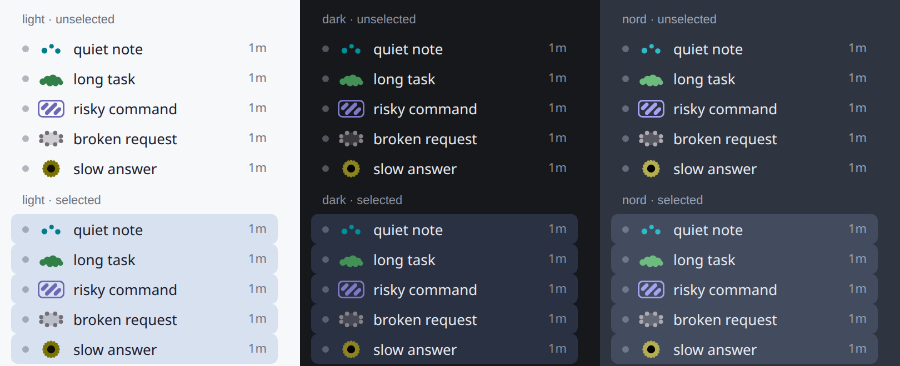

# The cuttlefish language

How cuttlefish-theme 2.0 says things with skin. The locked version of this vocabulary lives in the acceptance contract: [../contract/README.md](../contract/README.md) (§The words, §Feed inputs) and [../contract/config-vectors.json](../contract/config-vectors.json); this page is the plain-language mirror.

Two channels, and they never mix:

- **Hue = identity.** Which session this is. Allocated per session, held for the session's life, and two live sessions never share one (the acceptance tests pin 20 live sessions → 20 distinct hues, at least 30° apart). Hues avoid the amber/red part of the wheel on purpose, so the skin never competes with core's own alarm colours.
- **Pattern + brightness = state.** What the session is doing right now. A state change is a pattern change (plus a short bloom); it is never a hue change.

## Signals

A signal is a condition the plugin can detect on a session. There are nine:

| signal | means | where it comes from |
|---|---|---|
| `idle` | nothing happening | the absence of the others; the baseline |
| `busy` | a turn is running | the host's own busy state |
| `tool` | a tool call is running | `tool.start` / `tool.complete` events |
| `needs_input` | the session is blocked on you | the Python half's approval/clarify hooks |
| `failed` | a model call failed | a non-retryable API error (Python half) or an errored turn |
| `unseen` | a turn finished while you were elsewhere | a turn completed while another session was focused |
| `compacting` | the session is compacting | a `status.update` event |
| `subagents` | subagents are running | `subagent.start` / `subagent.complete` events |
| `offline` | the gateway connection is down | the host state snapshot |

A session can carry several signals at once. Which one speaks is decided by priority, next.

## From signals to state

A **state** is a named entry of `settings.states`: `{when, pattern, priority, label}`. `when` is the signal that triggers it. Among the signals a session currently carries, the state with the **highest priority** is the one shown. With the default presets that gives:

```
needs you (100)  >  error (80)  >  working (60)  >  finished unseen (40)  >  resting (0)
```

So a session that needs you beats everything else — that is the point of the ladder — and a session that is both busy and compacting shows `working`, because no default state listens to `compacting` (add one, as below, and its priority decides).

## The five presets

The states that ship, exactly as they resolve from an empty config:

| state | `when` | pattern | priority | label |
|---|---|---|---|---|
| `resting` | `idle` | `mottle` | 0 | *(empty — nothing to say)* |
| `working` | `busy` | `clouds` | 60 | working |
| `needs_you` | `needs_input` | `zebra` | 100 | needs you |
| `error` | `failed` | `blanch` | 80 | error |
| `finished_unseen` | `unseen` | `eyespot` | 40 | done |

The label is what the status-bar strip says in words.

## The five pattern kinds

`mottle`, `clouds`, `zebra`, `blanch`, `eyespot` — the whole visual vocabulary. In the language of the spec: resting is a **calm mottle**, working is **slow passing clouds**, needs you is **high-contrast zebra stripes**, error is **blanching to pale**, finished-unseen is **one dark eye-spot**. Clouds and zebra stripes run along one of the four canonical orientations (0/45/90/135°), which is part of what lets the acceptance tests tell them apart by reading pixels.

A **pattern** is a kind plus three dials: `{base, density, contrast, scale}`. Ranges: `density` 0.25–4, `contrast` 0–2, `scale` 0.25–4; all default to 1.

## The pictures (v2.1)

Every plugin surface draws the same five pictures. The shape is the state; the hue is the session; and every mark is dark enough on its row to pass WCAG 2.2 SC 1.4.11 (≥ 3:1 against the row, selected or not, light or dark — measured from rendered pixels by `tools/design/measure.mjs`, table in [design/contrast-table.md](design/contrast-table.md)).



| state | sidebar mark (24×16) | field (focused chat) | composer rim (10 px) | status strip |
|---|---|---|---|---|
| resting | three small dots; nothing else | sparse faint mottle | a 1 px hairline | the mark + "resting" |
| working | one solid cloud (seven lobes) | clouds drift (left half stays faint) | a train of cloud lobes on a thin track | cloud + "working" |
| needs you | outlined chip, bold diagonal stripes | diagonal bands of big dots (right of the text) | full-width bold diagonal stripes | stripes chip + "needs you" |
| error | pale grey chip, hollow broken ring, **no hue** | big pale, colourless blobs | pale wash inside a broken (dashed) outline | grey ring + "error" |
| finished (unseen) | solid iris, one big dark pupil | one big dark disc in the right gutter | a hairline with one dark eye | eye + "done" |

Rules the pictures obey:

1. **Silhouette, not hue.** No two marks share an outline: dots / cloud / striped plate / hollow ring / disc-with-pupil. Pairwise overlap is measured (worst pair ≤ 0.55 IoU); a grey-scale screenshot still reads.
2. **Error is the only grey mark.** Blanching *is* the loss of hue, so error is drawn in the near-achromatic pigment; it is also the only hollow mark.
3. **Rest is small, not faint.** The resting mark is three small dots at full contrast — quiet because there is little of it, not because it is pale.
4. **One working family.** Cloud lobes (overlapping circles of unequal radius) are the working picture on every surface: the sidebar cloud, the rim's lobe train, the big soft lobes of the field.
5. **The field never smothers text.** Organs left of half the page width (where the text column is) are drawn at half size and half ink, so the stripes and blobs live in the open space on the right.
6. **A seen, finished session is resting.** The eye appears only while a finished turn is unseen.


## Remapping and adding states

Under `plugins.entries.cuttlefish-theme.settings.states` in `config.yaml`:

**Remap a preset** — give any of its four fields; the ones you don't give keep their defaults:

```yaml
states:
  needs_you:
    pattern: mottle      # calmer "needs you", same priority and label
```

**Add a state** — it needs three things: a `when` (a known signal), a `pattern` (a known pattern), and a `priority` (−1000…1000). The `label` is optional and defaults to the state's name; it is capped at 24 characters:

```yaml
states:
  compacting:
    when: compacting
    pattern: zebra
    priority: 50         # beats finished-unseen (40), loses to working (60)
    label: compacting
```

**Remove a preset** — set it to `null`. `resting` cannot be removed: something must always show at rest.

What happens to a mistake is fixed by the shared test vectors, and it is never fatal:

- a rejected **field** keeps its default (a bad priority on `working` leaves 60 in place);
- a rejected **new** state or pattern is dropped whole;
- unknown keys are reported as warnings, not errors;
- garbage anywhere still yields a usable config plus one warning per miss.

`hermes cuttlefish doctor` prints the resolved settings and the warnings; `hermes cuttlefish legend` prints the state table as your config resolves it right now.

## Patterns: tuning and adding

Under `...settings.patterns`:

```yaml
patterns:
  mottle:
    contrast: 1.3        # tune a built-in: the dials change, the base is fixed
  dense:
    base: mottle         # add one: a base is required, the dials default to 1
    density: 1.5
```

A state may point at a user-added pattern (`needs_you: {pattern: dense}`); a preset pointed at an unknown pattern keeps its own, with a warning. Built-in patterns cannot change their base, and cannot be removed — the five kinds are the vocabulary.

## Motion and the bloom

`motion` has three modes, and `prefers-reduced-motion` outranks all of them:

| mode | at rest | while working | on a state change |
|---|---|---|---|
| `still` (default) | nothing moves | slow passing clouds | one short bloom, then it settles |
| `alive` | a slow twinkle | slow passing clouds | one short bloom, then it settles |
| `off` | nothing moves | nothing moves | nothing moves |

The **bloom** is the only way a change announces itself: for a few seconds (`BLOOM_MS`, pinned by the acceptance tests to at most 4 s) the field is noticeably brighter, then it settles to its quiet, readable pattern. Under `prefers-reduced-motion` or `motion: off` there is no bloom — the change is a plain pattern change. Everything runs on one budgeted animation loop that parks itself when nothing moves.

## How state arrives

**From the Desktop host** (always on): the host state snapshot, session info, message start/complete, tool start/complete, status updates, subagent start/complete.

**From the Python half** (needs `cuttlefish-theme` in `plugins.enabled`): five observer hooks — approval pre/post, human-input request/resolved, API-request error — become two plugin events, `plugin.cuttlefish-theme.needs_you` and `plugin.cuttlefish-theme.error`, plus a `python.health` ping. They carry session identity and state only; never prompt, command or error text.

**By polling** (the fallback, Python half off or unknown): the Desktop asks for `session.active_list` every 3–10 seconds, and only while it has no healthy Python half.

Semantics the tests pin:

- `busy` comes only from the host's busy state; a message starting alone never makes a session busy (a killed backend leaves a start with no complete).
- while the gateway is not `open`, a session carries `offline` and never `busy`;
- `failed` is sticky until that session's next message starts;
- `unseen` means a turn completed while another session was focused; focusing that session clears it;
- a needs-you request clears when it is answered (its own resolve) or when that session's message completes.
